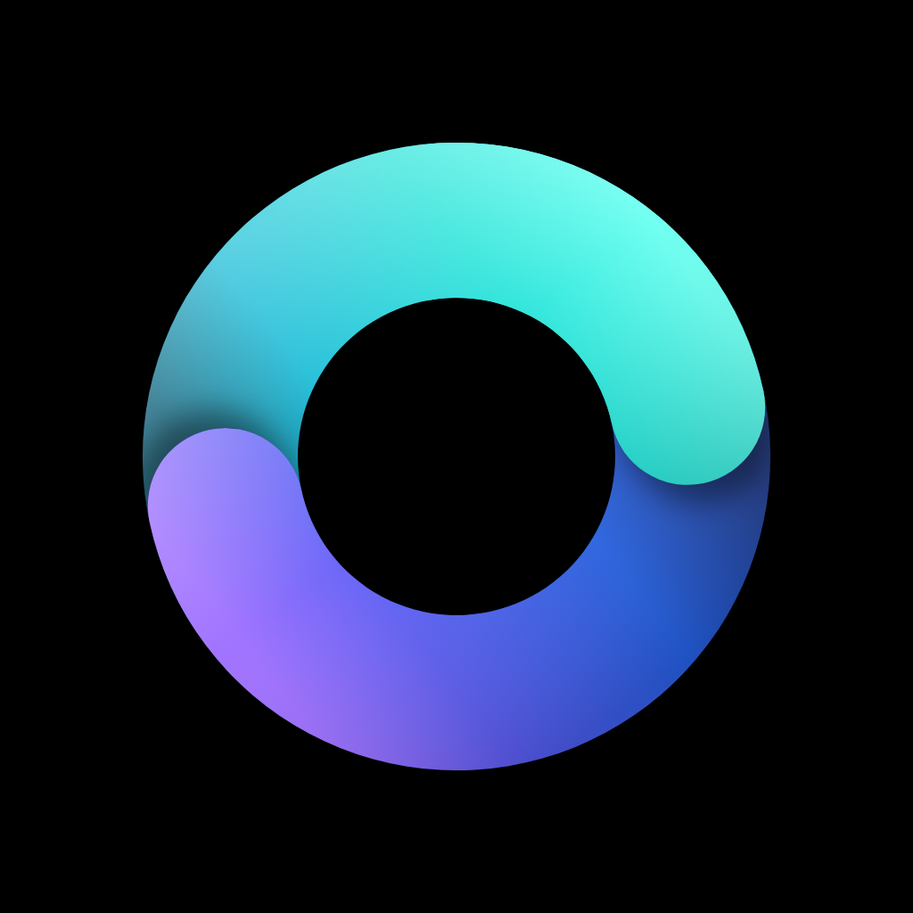
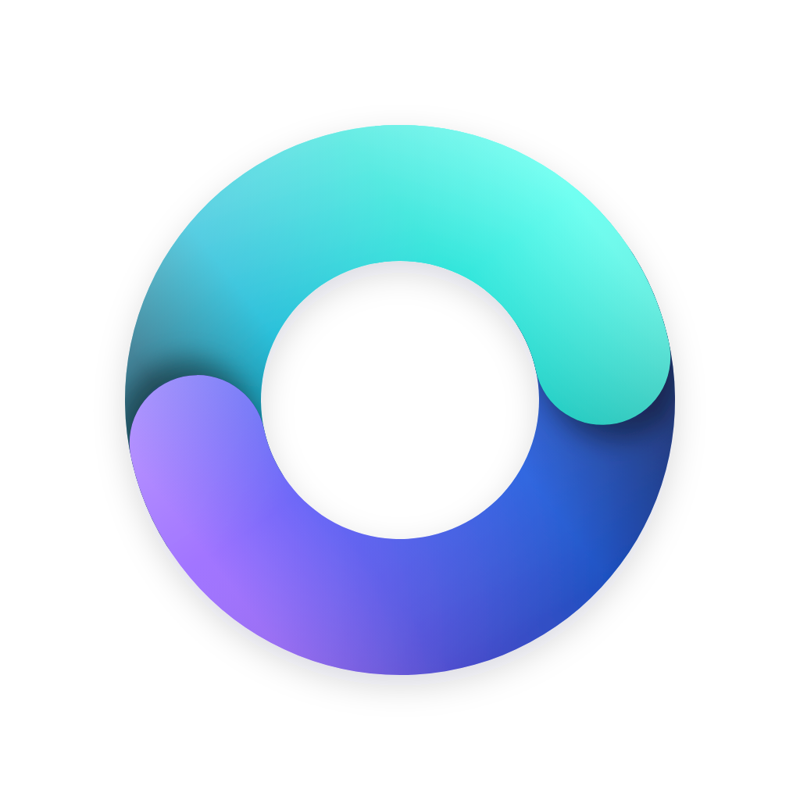

# Omnifull-401-Lab Official Brand Kit (v1.0 — 8 Specs)

Official vector (`.svg`) and high-resolution raster (`1024×1024 .png`) logo assets for **Omnifull-401-Lab** — an interdisciplinary engineering team spanning embedded hardware, PCB design, firmware, mechanical structures, and AI/algorithms.

The brand kit covers **8 complete specifications (16 files total)** built on one unified double-folded Mobius `O` geometry (`R = 352`, `r = 178`, `148°–348°` / `328°–528°`):

- **Digital Color (`O1`, 4 variants)**: Deep midnight avatar, transparent overlay, solid pure-black (`#000000`), and solid pure-white (`#FFFFFF`).
- **Hardware & Monochrome (`10D`, 4 variants)**: Transparent pure-white silkscreen, transparent pure-black document mark, solid black-bg white emblem, and solid white-bg black emblem. All `10D` SVGs use **pure closed `<path>` geometry** (zero `<mask>`, zero `<filter>`, zero `<clipPath>`) so **LCEDA (立创EDA), Altium Designer, KiCad, SolidWorks, and laser engravers** import them natively without losing the crescent gaps.

---

## Color Series (`O1` 全彩系列 · 4 张)

| # | Preview | Files (`.png` / `.svg`) | Background | Recommended Usage / 适用场景 |
| :---: | :---: | :--- | :--- | :--- |
| **01** |  | [`logo-avatar-dark.png`](./logo-avatar-dark.png) [`logo-avatar-dark.svg`](./logo-avatar-dark.svg) | Midnight radial (`#11182B→#06080F`) | **GitHub 组织头像 / 暗色质感头像** |
| **02** |  | [`logo-color-transparent.png`](./logo-color-transparent.png) [`logo-color-transparent.svg`](./logo-color-transparent.svg) | Transparent (`Alpha = 0`) | **PPT / 宣传海报 / 答辩视频 / 网页透明叠加** |
| **05** |  | [`logo-color-black-bg.png`](./logo-color-black-bg.png) [`logo-color-black-bg.svg`](./logo-color-black-bg.svg) | Solid pure black (`#000000`) | **纯黑背景 PPT / OLED 深色头像 / 黑底横幅无缝贴图** |
| **06** |  | [`logo-color-white-bg.png`](./logo-color-white-bg.png) [`logo-color-white-bg.svg`](./logo-color-white-bg.svg) | Solid pure white (`#FFFFFF`) | **亮色平台头像 / 白底海报 / 公文与表格直接贴图** |

---

## Monochrome & Hardware Series (`10D` 单色丝印与黑白系列 · 4 张)

| # | Preview | Files (`.png` / `.svg`) | Background | Recommended Usage / 适用场景 |
| :---: | :---: | :--- | :--- | :--- |
| **03** |  | [`logo-silkscreen-white.png`](./logo-silkscreen-white.png) [`logo-silkscreen-white.svg`](./logo-silkscreen-white.svg) | Transparent (`Alpha = 0`) | **深色 / 黑色 / 哑光绿 PCB 丝印 & 金属外壳激光雕刻**（纯路径 `428 B`） |
| **04** |  | [`logo-silkscreen-black.png`](./logo-silkscreen-black.png) [`logo-silkscreen-black.svg`](./logo-silkscreen-black.svg) | Transparent (`Alpha = 0`) | **白底文档 / 报告封面 / 白色 3D 打印外壳贴图**（纯路径 `428 B`） |
| **07** |  | [`logo-mono-black-bg.png`](./logo-mono-black-bg.png) [`logo-mono-black-bg.svg`](./logo-mono-black-bg.svg) | Solid pure black (`#000000`) | **暗色极简黑白队徽 / 机箱贴纸 / 纯黑底单色头像** |
| **08** |  | [`logo-mono-white-bg.png`](./logo-mono-white-bg.png) [`logo-mono-white-bg.svg`](./logo-mono-white-bg.svg) | Solid pure white (`#FFFFFF`) | **亮色极简黑白队徽 / 黑白打印公文 / 印章风格应用** |

---

## Official Color Palette / 官方标准色值

| Role | Hex | Usage |
| :--- | :--- | :--- |
| **Cyan Highlight** | `#67FFF0` → `#06B6D4` | Upper Mobius arc gradient |
| **Electric Indigo** | `#2563EB` → `#9B6BFF` | Lower Mobius arc gradient |
| **Midnight Canvas** | `#11182B` → `#0A0E1A` → `#06080F` | Official dark avatar backdrop |
| **Pure Black / White** | `#000000` / `#FFFFFF` | Solid monochrome & light/dark backgrounds |
| **Document Ink** | `#0F1219` | Black monochrome mark for documents & light shells |

---

## Hardware Import Tips / PCB 丝印与结构件导入建议

- **LCEDA (立创EDA) / KiCad / Altium Designer**: Prefer [`logo-silkscreen-white.svg`](./logo-silkscreen-white.svg) (pure transparent 2-path SVG, zero background rect). Recommended minimum physical diameter on PCB silkscreen is **≥ 6 mm** so the crescent gaps remain sharp after fabrication.
- **SolidWorks / Fusion 360 / Laser Cutter**: Import [`logo-silkscreen-black.svg`](./logo-silkscreen-black.svg) or [`logo-silkscreen-white.svg`](./logo-silkscreen-white.svg) directly as sketch contours.
- **Do Not Modify Proportions**: Always scale uniformly (`1:1` aspect ratio).
