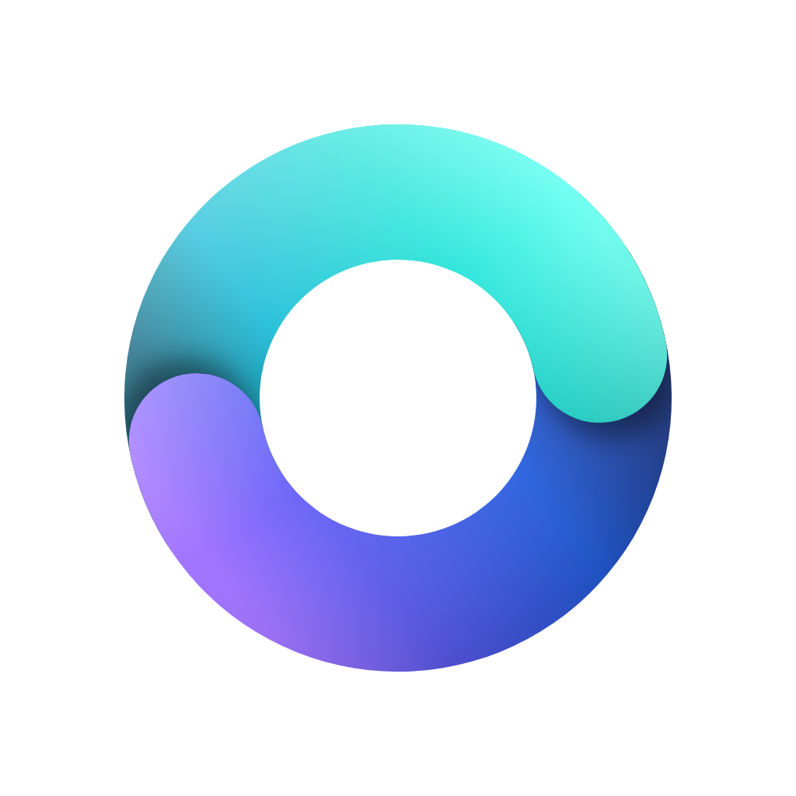
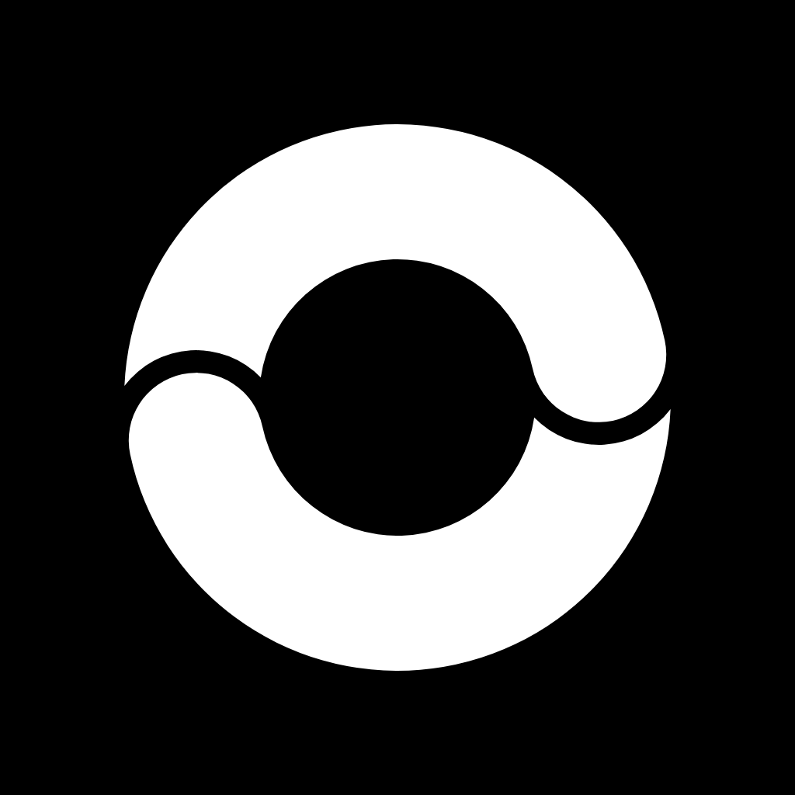
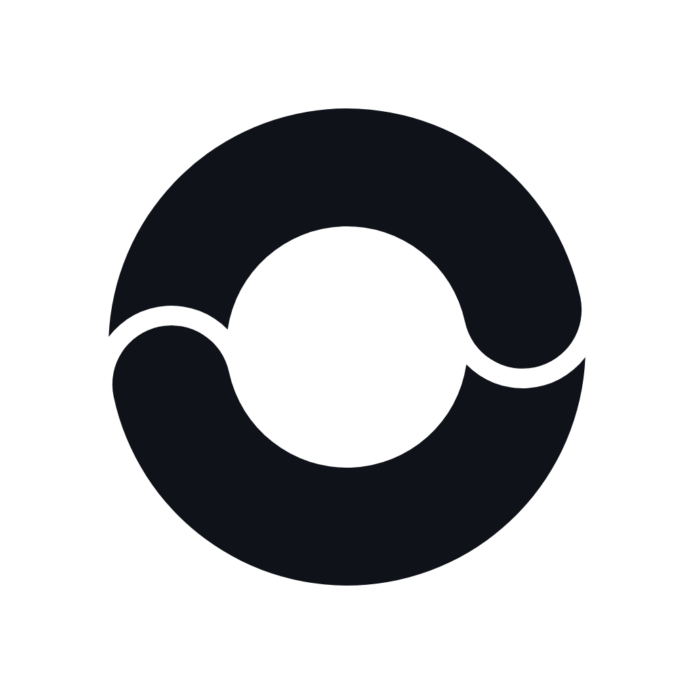
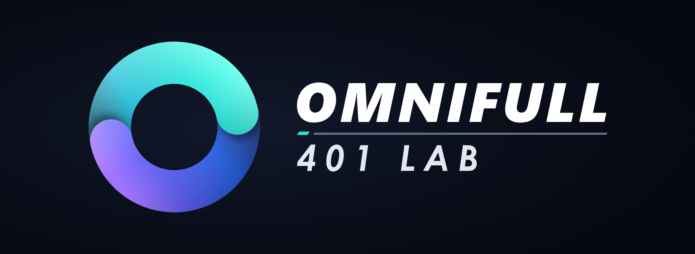
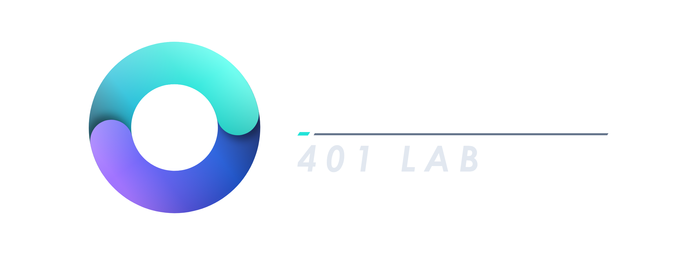
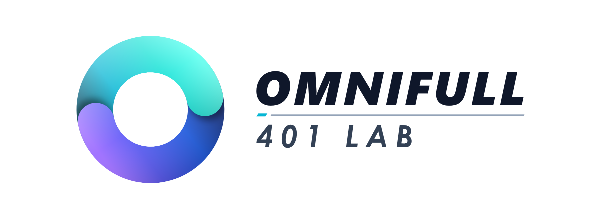
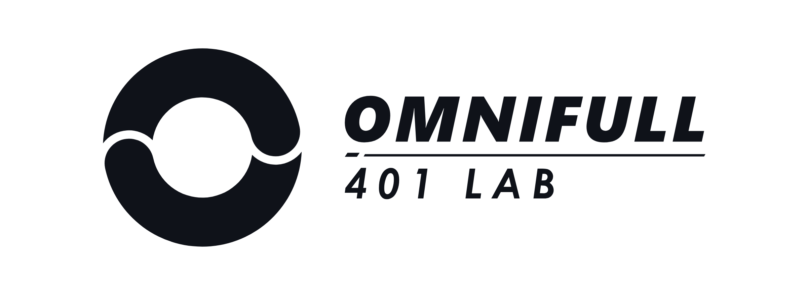

# Omnifull-401-Lab Official Brand Kit (v1.1 — 13 Specs)

Official vector (`.svg`) and high-resolution raster (`.png`) brand assets for **Omnifull-401-Lab** — an interdisciplinary engineering team spanning embedded hardware, PCB design, firmware, computer vision, and intelligent robotics.

The brand kit covers **13 complete production specifications (26 files total)** sharing one unified double-folded Mobius `O` geometry (`R = 352`, `r = 178`, `148°–348°` / `328°–528°`):

- **Square Emblems (`01`–`08`, `1024×1024`)**: 4 digital color (`O1`) + 4 hardware/monochrome (`10D`) variants.
- **Horizontal Nameplates & PCB Lockups (`09`–`13`, `2400×880`, `F5A` Kinetic Italic)**: Original `O1`/`10D` emblem paired with `OMNIFULL` (`Segoe UI Black Italic`), cyan speed-slash divider, and `401 LAB` (`Century Gothic Bold Italic`). All characters and shapes are converted to **pure closed SVG `<path>` outlines** (zero `<text>`, zero `<mask>`, zero `<filter>` in silkscreen SVGs) for 100% font-independent import into **LCEDA (立创EDA), Altium Designer, KiCad, SolidWorks, and laser engravers**.

---

## 1. Square Color Emblems (`O1` 全彩单徽标 · 4 套)

| # | Preview | Files (`.png` / `.svg`) | Background | Recommended Usage / 适用场景 |
| :---: | :---: | :--- | :--- | :--- |
| **01** |  | [`logo-avatar-dark.png`](./logo-avatar-dark.png) [`logo-avatar-dark.svg`](./logo-avatar-dark.svg) | Midnight radial (`#11182B→#06080F`) | **GitHub 组织头像 / 暗色质感头像** |
| **02** |  | [`logo-color-transparent.png`](./logo-color-transparent.png) [`logo-color-transparent.svg`](./logo-color-transparent.svg) | Transparent (`Alpha = 0`) | **PPT / 宣传海报 / 答辩视频 / 网页透明叠加** |
| **05** |  | [`logo-color-black-bg.png`](./logo-color-black-bg.png) [`logo-color-black-bg.svg`](./logo-color-black-bg.svg) | Solid pure black (`#000000`) | **纯黑背景 PPT / OLED 深色头像 / 黑底横幅** |
| **06** |  | [`logo-color-white-bg.png`](./logo-color-white-bg.png) [`logo-color-white-bg.svg`](./logo-color-white-bg.svg) | Solid pure white (`#FFFFFF`) | **亮色平台头像 / 白底海报 / 文档贴图** |

---

## 2. Square Monochrome & PCB Silkscreen Emblems (`10D` 单色徽标 · 4 套)

| # | Preview | Files (`.png` / `.svg`) | Background | Recommended Usage / 适用场景 |
| :---: | :---: | :--- | :--- | :--- |
| **03** |  | [`logo-silkscreen-white.png`](./logo-silkscreen-white.png) [`logo-silkscreen-white.svg`](./logo-silkscreen-white.svg) | Transparent (`Alpha = 0`) | **深色 / 黑色 / 绿油 PCB 纯图标丝印 & 黑铝激光雕刻**（纯路径 `428 B`） |
| **04** |  | [`logo-silkscreen-black.png`](./logo-silkscreen-black.png) [`logo-silkscreen-black.svg`](./logo-silkscreen-black.svg) | Transparent (`Alpha = 0`) | **白底文档 / 报告封面 / 白色 3D 打印外壳**（纯路径 `428 B`） |
| **07** |  | [`logo-mono-black-bg.png`](./logo-mono-black-bg.png) [`logo-mono-black-bg.svg`](./logo-mono-black-bg.svg) | Solid pure black (`#000000`) | **暗色极简黑白队徽 / 机箱贴纸 / 纯黑底单色头像** |
| **08** |  | [`logo-mono-white-bg.png`](./logo-mono-white-bg.png) [`logo-mono-white-bg.svg`](./logo-mono-white-bg.svg) | Solid pure white (`#FFFFFF`) | **亮色极简黑白队徽 / 黑白打印公文** |

---

## 3. Horizontal Nameplates & PCB Lockups (`F5A` 硬核竞速斜体横向铭牌 · 5 套)

| # | Preview | Files (`2400×880 .png` / pure-path `.svg`) | Background | Recommended Usage / 适用场景 |
| :---: | :---: | :--- | :--- | :--- |
| **09** |  | [`lockup-dark-bg.png`](./lockups/lockup-dark-bg.png) [`lockup-dark-bg.svg`](./lockups/lockup-dark-bg.svg) | Midnight radial (`#11182B→#06080F`) | **GitHub 横幅 / 深色 PPT 封面 / 宣传展板主视觉** |
| **10** |  | [`lockup-color-for-dark.png`](./lockups/lockup-color-for-dark.png) [`lockup-color-for-dark.svg`](./lockups/lockup-color-for-dark.svg) | Transparent (`Alpha = 0`, white text) | **深色 PPT / 视频片头 / 黑色 UV 彩印面板叠加** |
| **11** |  | [`lockup-color-for-light.png`](./lockups/lockup-color-for-light.png) [`lockup-color-for-light.svg`](./lockups/lockup-color-for-light.svg) | Transparent (`Alpha = 0`, dark text) | **白色 PPT / 技术报告封面 / 白底海报叠加** |
| **12** |  | [`lockup-silkscreen-white.png`](./lockups/lockup-silkscreen-white.png) [`lockup-silkscreen-white.svg`](./lockups/lockup-silkscreen-white.svg) | Transparent (`Alpha = 0`, `#FFFFFF`) | **黑/绿油 PCB 顶层带字丝印 & 黑铝激光雕刻**（零 `<text>` 纯路径 SVG） |
| **13** |  | [`lockup-silkscreen-black.png`](./lockups/lockup-silkscreen-black.png) [`lockup-silkscreen-black.svg`](./lockups/lockup-silkscreen-black.svg) | Transparent (`Alpha = 0`, `#0F1219`) | **白油 PCB / 白色 3D 打印外壳 / 银铝件 / 黑白报告**（零 `<text>` 纯路径 SVG） |

---

## Official Color Palette / 官方标准色值

| Role | Hex | Usage |
| :--- | :--- | :--- |
| **Cyan Highlight** | `#67FFF0` → `#06B6D4` | Upper Mobius arc gradient & speed-slash accent |
| **Electric Indigo** | `#2563EB` → `#9B6BFF` | Lower Mobius arc gradient |
| **Midnight Canvas** | `#11182B` → `#0A0E1A` → `#06080F` | Official dark avatar & banner backdrop |
| **Pure Black / White** | `#000000` / `#FFFFFF` | Solid monochrome & silkscreen inks |
| **Document Ink** | `#0F1219` | Black monochrome mark for documents & light shells |

---

## Hardware Import Tips / PCB 丝印与结构件导入建议

- **LCEDA (立创EDA) / KiCad / Altium Designer**:
  - Icon-only silkscreen: import [`logo-silkscreen-white.svg`](./logo-silkscreen-white.svg) (recommended physical diameter **≥ 6 mm**).
  - Full horizontal nameplate silkscreen: import [`lockups/lockup-silkscreen-white.svg`](./lockups/lockup-silkscreen-white.svg) (recommended physical width **≥ 18–25 mm** so the italic sub-line stays crisp after board fabrication).
- **SolidWorks / Fusion 360 / Laser Cutter**: Import any `*-silkscreen-*.svg` directly as closed sketch contours (zero `<text>`, zero `<mask>`).
- **Do Not Modify Proportions**: Always scale uniformly (`1:1` aspect ratio).
