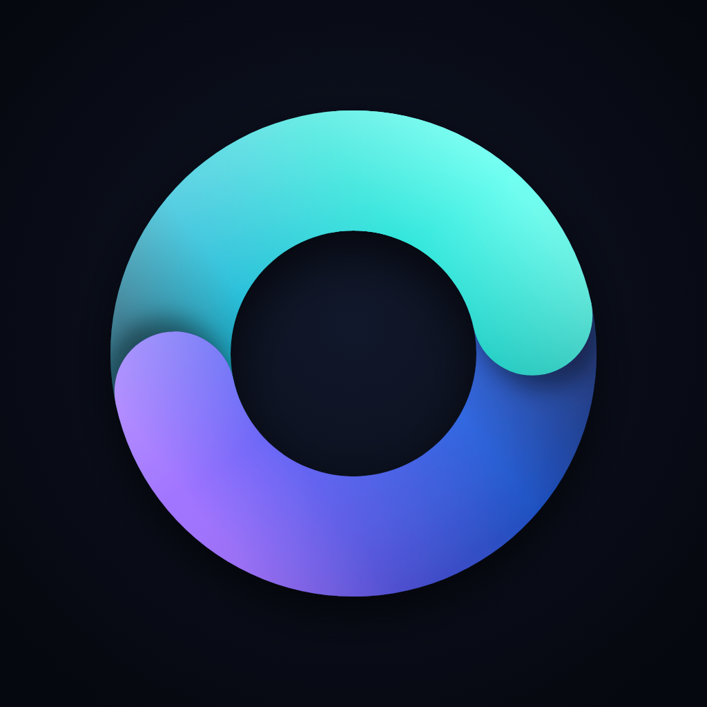
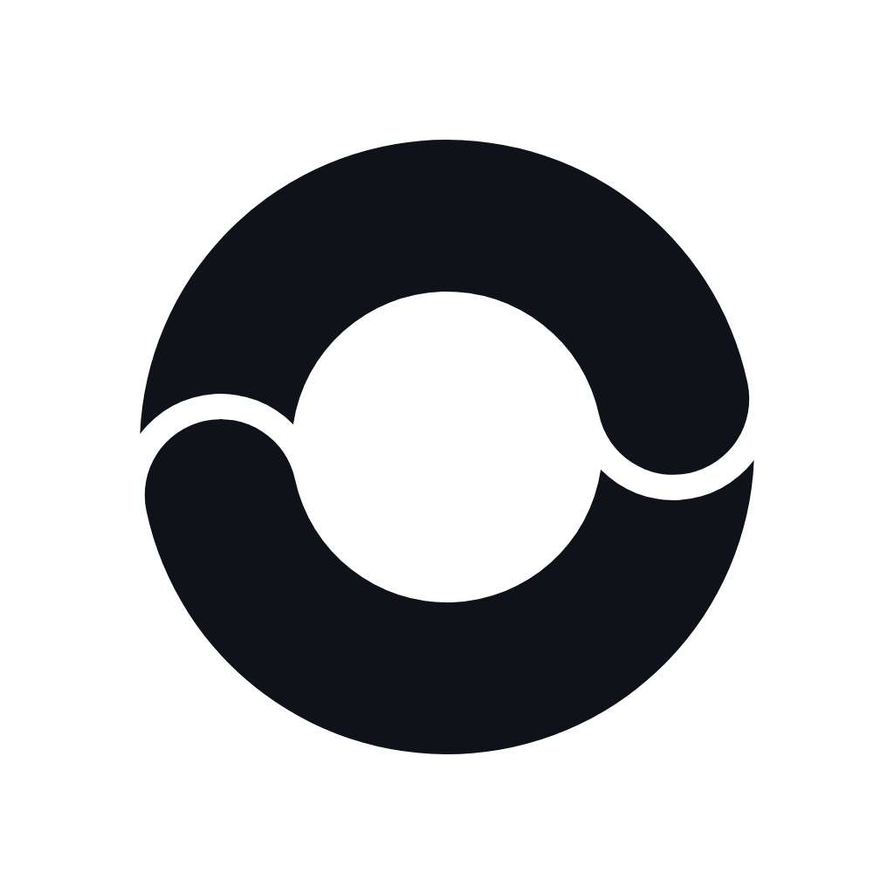

# Omnifull-401-Lab Official Brand Kit (v1.0)

Official vector (`.svg`) and high-resolution raster (`1024×1024 .png`) logo assets for **Omnifull-401-Lab** — an interdisciplinary engineering team spanning embedded hardware, PCB design, firmware, mechanical structures, and AI/algorithms.

The emblem uses a unified dual-variant system sharing the exact same double-folded Mobius `O` geometry (`R = 352`, `r = 178`, `148°–348°` / `328°–528°`):

- **Digital Color (`O1`)**: Smooth cyan-to-violet gradient fold with soft overlap shadow for screens, avatars, slides, and posters.
- **Hardware Monochrome (`10D`)**: Identical outer/inner radii with exact `29px` concentric crescent cutouts, constructed from **two pure closed SVG `<path>` shapes** (`428 bytes`, zero `<mask>`, zero `<filter>`, zero `<clipPath>`) so **LCEDA (立创EDA), Altium Designer, KiCad, SolidWorks, and laser engravers** import it cleanly without losing the cutout gap.

---

## Asset Matrix / 四大官方规格一览

| # | Preview | Files (`.png` / `.svg`) | Recommended Usage / 适用场景 |
| :---: | :---: | :--- | :--- |
| **1** |  | [`logo-avatar-dark.png`](./logo-avatar-dark.png) [`logo-avatar-dark.svg`](./logo-avatar-dark.svg) | **GitHub 组织头像 / 社交账号头像** Dark midnight radial backdrop (`#06080F`–`#11182B`), crisp at both `40px` icon size and full resolution. |
| **2** |  | [`logo-color-transparent.png`](./logo-color-transparent.png) [`logo-color-transparent.svg`](./logo-color-transparent.svg) | **PPT / 宣传海报 / 答辩视频 / 网页叠加** True transparent background (`Alpha = 0`), drop directly onto dark or light layouts. |
| **3** |  | [`logo-silkscreen-white.png`](./logo-silkscreen-white.png) [`logo-silkscreen-white.svg`](./logo-silkscreen-white.svg) | **深色 / 黑色 / 哑光绿 PCB 丝印 & 金属外壳激光雕刻** Pure white (`#FFFFFF`), transparent background, **mask-free pure SVG paths** ready for EDA/CAD import. |
| **4** |  | [`logo-silkscreen-black.png`](./logo-silkscreen-black.png) [`logo-silkscreen-black.svg`](./logo-silkscreen-black.svg) | **白底文档 / 技术报告封面 / 白色 3D 打印外壳 / 单色印刷** Deep obsidian (`#0F1219`), transparent background, **mask-free pure SVG paths**. |

---

## Official Color Palette / 官方标准色值

| Role | Hex | Usage |
| :--- | :--- | :--- |
| **Cyan Highlight** | `#67FFF0` → `#06B6D4` | Upper Mobius arc gradient (signal / algorithm vitality) |
| **Electric Indigo** | `#2563EB` → `#9B6BFF` | Lower Mobius arc gradient (embedded / systems depth) |
| **Midnight Canvas** | `#0A0E1A` (`#11182B` center → `#06080F` edge) | Official dark avatar & dark-mode slide background |
| **Silkscreen White** | `#FFFFFF` | Dark PCB silkscreen & anodized aluminum laser engraving |
| **Document Ink** | `#0F1219` | White-paper reports, stickers, and light chassis marks |

---

## Hardware Import Tips / PCB 丝印与结构件导入建议

- **LCEDA (立创EDA) / KiCad / Altium Designer**: Prefer [`logo-silkscreen-white.svg`](./logo-silkscreen-white.svg) (or `.png` if using bitmap-to-silkscreen). Recommended minimum physical diameter on PCB silkscreen is **≥ 6 mm** so the crescent gaps remain sharp after board fabrication.
- **SolidWorks / Fusion 360 / Laser Cutter**: Import [`logo-silkscreen-black.svg`](./logo-silkscreen-black.svg) or [`logo-silkscreen-white.svg`](./logo-silkscreen-white.svg) directly as sketch contours (each file contains exactly 2 closed geometric loops with zero overlapping strokes).
- **Do Not Modify Proportions**: Always scale uniformly (`1:1` aspect ratio) and preserve clear padding around the outer ring.
